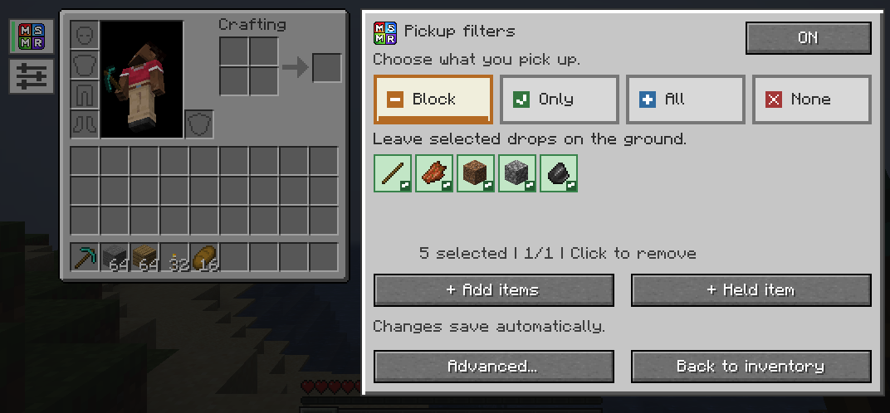
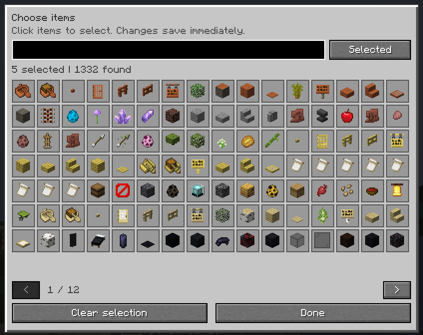
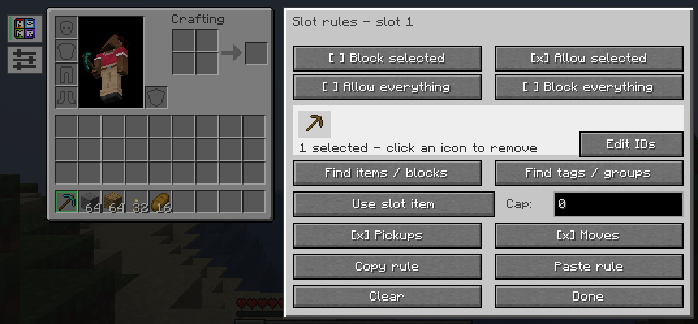
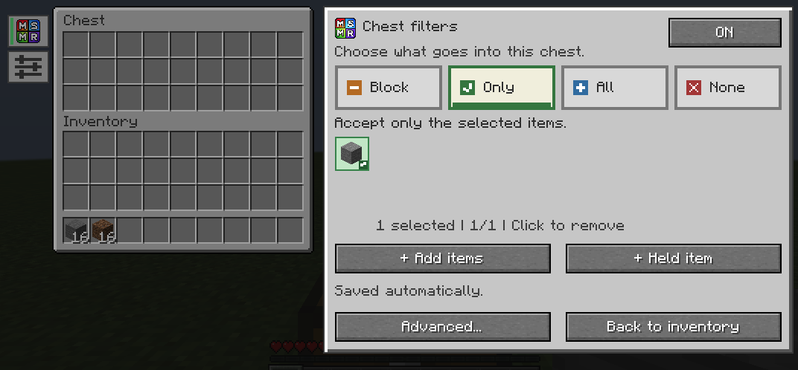

<div align="center">


# My Slots, My Rules

**Keep the loot. Leave the clutter.**

Minecraft **1.21.1** · **Fabric & NeoForge** · **0.8.0**

**[⬇ Fabric](https://github.com/TAS-69/MSMR/releases/download/v0.8.0/msmr-fabric-1.21.1-0.8.0.jar) · [⬇ NeoForge](https://github.com/TAS-69/MSMR/releases/download/v0.8.0/msmr-neoforge-1.21.1-0.8.0.jar) · [📖 Wiki](https://github.com/TAS-69/MSMR/wiki)**

</div>

## Does this annoy you?

You throw out sticks or rotten flesh, then walk straight back into them. **Inventory full. Again.**

**MSMR blocks unwanted drops before they enter your inventory.** Choose the items you want to leave behind. They stay on the ground.



### Pick it. Block it. Done.

**①** Open your inventory → click the **MSMR tab** on the left.<br>
**②** Click **+ Add items** → select their pictures.<br>
**③** Leave the mode on **Block**. Your filter is already active.

**Changes save automatically.**

| − **Block** | ✓ **Only** | + **All** | × **None** |
| :---: | :---: | :---: | :---: |
| Skip selected drops | Collect only selected drops | Collect everything | Collect nothing |



**Search by name. Click to select. Click again to remove.** Pause the whole-inventory pickup filter whenever you need it.

## Have you ever wanted a pickaxe-only hotbar slot?

Or one setup for mining, another for building, and a third for farming?

Open **Advanced** for more control:

- **Slot rules** — reserve individual slots, set stack caps, and copy or paint filters.
- **Tags & categories** — choose all swords, seeds, pickaxes, logs, or matching blocks.
- **Profiles** — save, switch, copy, and delete your player-inventory setups.
- **Movement rules** — filter manual placement and supported shift-click transfers separately from pickups.



## A different job for every chest

**Building blocks here. Farming supplies there. Each chest remembers its own rules.**

Open a chest → click the **MSMR tab** → choose what belongs. Whole-chest and slot filters save automatically, separately from your player inventory.



**Close it. Reconnect. Restart. Your chest setup stays put.** Double chests, trapped chests, and barrels are supported too. [Chest guide →](https://github.com/TAS-69/MSMR/wiki/Chest-Filters)

Player and chest rules persist per world/server. Other supported container rules last while the container is open.

## Install & play

Download **one JAR** for your loader, put it in your instance's **`mods`** folder, and launch Minecraft **1.21.1**.

| Playing where? | Pickup filtering needs |
| --- | --- |
| **Singleplayer** | MSMR on your client. **No Fabric API required.** |
| **Multiplayer** | MSMR on the client **and server**. Fabric endpoints also need Fabric API; NeoForge includes networking. |

**You can join unsupported servers.** Local inventory tools still work; ground-pickup filtering shows **Unavailable**.

Requires Java **21**, Fabric Loader **0.16.9+** or NeoForge **21.1.80+**. [Installation help →](https://github.com/TAS-69/MSMR/wiki/Installation)

**[Pickup guide](https://github.com/TAS-69/MSMR/wiki/Pickup-Filters) · [Advanced tools](https://github.com/TAS-69/MSMR/wiki/Advanced-Filters) · [Profiles](https://github.com/TAS-69/MSMR/wiki/Profiles) · [Report a bug](https://github.com/TAS-69/MSMR/issues/new)**

<details>
<summary><strong>Build from source</strong></summary>

Use JDK 21 and the included wrapper:

```sh
./gradlew :common:test :fabric:build :neoforge:build
```

Windows: use `gradlew.bat`. Installable JARs appear in each loader's `build/libs` directory. [Development guide →](https://github.com/TAS-69/MSMR/wiki/Development)

</details>

[CC0 1.0](LICENSE) · [Release notes](CHANGELOG.md)
